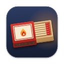

<p align="center"></p>

# Matchbox Dashboard

Turns an Android tablet into a live info screen that sits under or beside your Mac. A small menu bar app on the Mac does all the work; the tablet just shows the page.

- **Left side:** live Mac metrics: CPU, GPU, memory, disk (capacity + I/O), network throughput and periodic speed tests. They take the left half, or the left quarter with *Compact metrics* on.
- **Right side:** a big clock with a weather glance, plus a card carousel: weather, live scores with TV networks, headlines, YouTube uploads, anime countdowns, Bluesky posts, Steam wishlist releases, deals, achievements and news, exchange rates, a kanji of the hour, rain radar and Slickdeals.
- **Day / Night:** a warm Liquid Glass day theme, and an ultra high-contrast pure-black night theme. It switches when your Mac switches Light/Dark (including Auto at sunset) and can dim the tablet's backlight at night.
- **Standby:** when the Mac sleeps or locks, the metrics slide away and the clock and cards take the whole screen.

Everything is set up in a local web page on the Mac (the manager). No accounts are needed except an optional free Steam Web API key for the achievement and news cards.

## Requirements

- A Mac running macOS 14 or later. Developed on an Apple silicon Mac mini.
- An Android tablet running Android 8 or later, including Amazon Fire tablets (Fire OS 7+). The layout is designed for a 1024×600 landscape screen (it was built on a 12th‑gen Fire 7) and scales to fit others.
- To build from source: Xcode command-line tools, the Android SDK (platform 34) and JDK 17. With Homebrew: `brew install openjdk@17 android-platform-tools` plus the Android SDK from Android Studio or `brew install --cask android-commandlinetools`.

## Download

Get the **Matchbox-Dashboard-…-macOS.zip** file from the [latest release](https://github.com/taxfraud311/matchbox-dashboard/releases/latest). The release notes walk through the first launch: the app isn't notarized, so macOS asks you to allow it once under **System Settings › Privacy & Security**. Then follow *Tablet setup* below. Building from source is only needed if you want to change it.

## Pieces

| Folder | What it is |
|---|---|
| `mac/` | **Matchbox Dashboard.app**, a Swift menu bar app. It samples metrics, proxies weather (Open‑Meteo), scores (ESPN) and RSS, and serves the display and manager on port 8787. It also runs `adb reverse` automatically so the tablet works over the USB cable. |
| `web/display/` | The tablet dashboard, designed pixel-for-pixel for 1024×600. |
| `web/manager/` | The manager at **http://localhost:8787/manager/**: live preview and every setting. It's only reachable from the Mac itself. |
| `android/` | **MatchboxDashboard.apk**, a 20 KB fullscreen kiosk WebView for Android and Fire OS. It tries USB first, then a saved or Bonjour-discovered Wi‑Fi address. It keeps the screen on, lets the Mac set brightness, and relaunches after reboot. |

## Build

```bash
git clone https://github.com/taxfraud311/matchbox-dashboard.git
cd matchbox-dashboard
./scripts/build.sh            # → build/Matchbox Dashboard.app and build/MatchboxDashboard.apk (APK is bundled inside the app)
./scripts/build.sh --install  # also copies to /Applications and opens the manager
```

The build looks for JDK 17 at `/opt/homebrew/opt/openjdk@17` (or `$JAVA_HOME_17`) and the Android SDK at `~/Library/Android/sdk` (or `$ANDROID_HOME`). The Mac app is signed ad hoc on your machine, so macOS doesn't block it.

## Tablet setup (once)

1. Turn on Developer options on the tablet: **Settings › About tablet** → tap **Build number** 7×. The menu names vary by brand; on Amazon Fire it's **Settings › Device Options › About Fire Tablet** → tap **Serial Number** 7×.
2. In **Developer options**, turn on **USB debugging**.
3. `brew install android-platform-tools` on the Mac (if adb isn't installed).
4. Plug the tablet into the Mac and tap **Allow** (tick *Always allow*).
5. Amazon Fire tablets are picked up automatically. For any other tablet, open the manager and click **Use** next to it in the Tablet section.
6. Matchbox Dashboard menu bar icon → **Install App on Tablet** (or the button in the manager).

After that, the display opens by itself whenever the tablet is plugged in or reboots. If the display process dies (for example during a WebView update), the Mac relaunches it.

**Wi‑Fi instead of USB:** in the tablet's web browser, open `http://<mac-ip>:8787/download/MatchboxDashboard.apk` (the manager shows the address) and install it. Then long-press the top-left corner of the display to enter the address. The app also finds the Mac automatically via Bonjour.

## Notes

- Over adb, the Mac only touches Amazon Fire tablets (model `KF…`) and devices you've chosen with **Use** in the manager. Phones, TV boxes and other Android devices connected to the Mac are left alone unless you turn on *Use any Android device*.
- "Use the Mac's San Francisco font" streams `/System/Library/Fonts/SFNS*.ttf` from your Mac to your tablet. Apple's font license is written for Apple platforms, so switch it off if that matters to you. The tablet then falls back to its own font.
- **Compact metrics** (manager › Display) stacks the Mac metrics in one narrow column on the left quarter of the screen, so the clock and cards get three quarters.
- **Day mode colors** (manager › Display) has three options:
  - *Match Wallpaper* (default) samples five regions of your current wallpaper (Aerials included) and turns them into a bright pastel gradient, re-checked every 15 s.
  - *Custom* builds the gradient around a color you pick.
  - *Golden Gate* is the original warm palette.
- **YouTube card:** follow channels in manager › YouTube. Paste a channel URL or @handle, or import `subscriptions.csv` from [Google Takeout](https://takeout.google.com) (YouTube and YouTube Music › subscriptions). Matchbox Dashboard reads each channel's public upload feed, so no Google sign-in is needed. Shorts are hidden by default.
- **Anime card:** search for shows in manager › Anime, or link an AniList username. Countdowns use AniList's public airing schedule, which gives the Japanese broadcast time. Crunchyroll has no public API, so set *Crunchyroll release delay* if its simulcasts appear later.
- **Bluesky card:** add accounts in manager › Bluesky (@handle or profile link). Shows their newest posts with the first image and like/repost/reply counts, using Bluesky's public API with no sign-in. Reposts are optional.
- **Steam cards:** connect your profile in manager › Steam (profile link or SteamID). The wishlist must be public (Privacy › Game details).
  - *Steam · Coming soon* counts down to exact release dates. It shows the rough window when Steam only has one ("Q1 2027", "2027", "Coming soon"), and "Out now" for 3 days after release.
  - *Steam Deals* lists discounted wishlist games, biggest discount first, with sale end times. Set a minimum discount in the manager.
  - Store data refreshes every 30 minutes. The 1,500 highest-priority wishlist games are checked.
- **Steam achievements and news** need a free Steam Web API key (manager › Steam; get one at steamcommunity.com/dev/apikey). The key stays on the Mac: `/api/config` never returns it. Matchbox Dashboard looks at your 25 most recently played games:
  - *Achievements · Recently unlocked* shows what you've earned lately, with how many players have each one.
  - *Achievements · Within reach* lists locked achievements that most players have, favoring games you're furthest through. Steam doesn't publish per-achievement progress (the bars in the Steam client), so this is the best signal available.
  - *Steam News* shows official announcements for your 18 most recently played games from the last 60 days.
- **Exchange rates:** up to 4 currency pairs (manager › Exchange Rates), each with a 30-day chart. European Central Bank reference rates via Frankfurter, updated each business day.
- **Kanji of the hour:** a new kanji every hour from the level you pick (JLPT N5–N1, school grade, Jōyō…), with meanings, on/kun readings, three common words and an animated stroke order. Data from kanjiapi.dev and KanjiVG.
- **Radar:** RainViewer's rain radar looped over the last two hours on an OpenStreetMap base map, at the weather location or any place you choose. RainViewer's free tiles stop at zoom level 7.
- **Slickdeals:** Frontpage and/or Popular deals plus up to 8 categories or searches. Slickdeals has no category feeds, so each category is a search.
- **Tap any item for a QR code** (headlines, videos, games, posts, deals, achievements, kanji…) to open it on your phone, or tap **Open on Mac** to open it in the Mac's default browser. The Mac draws the code; scores link to ESPN's game page. The Mac only opens links the dashboard itself is showing, so nothing else on your network can make it open pages.
- **Screen timeout** (manager › Display): *Always On* (default), *After Inactivity* (1 minute to 2 hours without a touch), or *With Mac Idle* (off while the Mac's screen saver runs, its displays sleep, or it sleeps or logs out; the lock screen alone doesn't count). Over USB the Mac switches the tablet's screen off right away and, in *With Mac Idle*, back on when the Mac is in use again. Matchbox Dashboard never keeps the Mac awake: it holds no sleep assertion, only opts out of App Nap so the tablet keeps getting answers. Over Wi‑Fi the page goes black and the tablet's own screen timeout turns the panel off; press the power button to wake it.
- **Claude tile** (manager › Display › Claude Code usage, off by default): pick what it shows: *Context Left* in your most recent Claude Code session, or how much of your plan's *5-Hour Limit* or *Weekly Limit* you've used. Tap it for both limits, a 7-day chart and the busiest sessions. Token counts come from Claude Code's logs in `~/.claude` (usage numbers only, not the conversations).
  - Plan limits (Pro and Max) only reach the Mac through Claude Code's status line. **Connect** in the manager adds a small status line script that saves those numbers, plus the context window, to `~/Library/Application Support/Plinth` and then runs the status line you already had. **Disconnect** puts your settings back (a copy is kept as `~/.claude/settings.json.matchbox-backup`). The status line runs in the `claude` command in Terminal. Without it, a limit shows as 100% from the moment Claude Code reports you've hit it until it resets.
  - Once connected, the weekly reset time comes from Claude Code. Otherwise set the day and time from Claude's Settings › Usage. Chats in the Claude app's Chat tab aren't counted.
- **Stocks** (manager › Stocks): up to 8 stocks, ETFs, indexes or cryptocurrencies, four per card, each with today's price line against yesterday's close. Quotes from Yahoo Finance's public data refresh every 30 seconds while a market is open (exchanges may delay them 15–20 minutes) and every 15 minutes otherwise. Tap a line for its Yahoo Finance page.
- **Updates:** the Mac app checks this repository's GitHub releases when it opens and every 6 hours (manager › Updates; can be switched off). When a newer version is out, the manager shows a banner and the tablet shows a note, each dismissable until the next version. **Install and Relaunch** (manager, or **Install Update…** in the menu bar) downloads the release and checks it against GitHub's SHA-256 checksum, the bundle ID, the version number and the code signature. It then swaps the app in place and reopens it. A tablet on USB gets the new tablet app automatically if the update includes one. The manager's sidebar always shows the installed version. Updating from 1.2.0 or earlier needs one manual download, since those versions have no updater.
- **Long-press the card** to pause or resume the carousel, step through cards, or set the time per card (6–60 s). Pausing is remembered on the tablet; the time per card is saved to the Mac.
- **Disk:** the tile takes turns showing each connected drive (6 s each). Tap it to see what's using the space: a folder list and a WinDirStat-style treemap you can drill into. The first scan of a drive takes from seconds to a few minutes and is redone after 6 hours (or on *Rescan*). On the startup disk, macOS may ask about Desktop, Documents and Downloads. Without Full Disk Access, other apps' containers and a few protected folders are skipped and shown as *Not measured*.
- Thumbnails and cover art are fetched by the Mac (`/img`, allow-listed hosts only), so they show up on a USB-only tablet.
- **Standby:** when the Mac is about to sleep, log out, shut down or switch users, Matchbox Dashboard tells the tablet first. System sleep is held for about 1.6 s so the message gets through. The tablet then slides the metrics away and gives the clock, weather and cards the whole screen. If the Mac just stops answering for 20 s, the same happens with "Can't reach the Mac".
  - While the Mac is away, the tablet keeps the Mac's last known time and its cached data. It refreshes weather and scores directly if it has Wi‑Fi, and follows sunrise and sunset for day/night.
  - It even restarts from its cached copy if the tablet itself reboots in the meantime.
  - To test without sleeping the Mac: `curl -X POST localhost:8787/api/action -d '{"action":"presence","state":"sleeping","seconds":30}'`.
- **Touch:**
  - Tap a metric tile for details: per-core load, top apps by CPU/memory/disk/network with their icons, memory breakdown, volumes, GPU info, router/DNS, and a Run Speed Test button.
  - Tap the clock for the world clock (cities are set in the manager), or the temperature or weather card for the full forecast.
  - Swipe the card left or right to change it; it stays put for 30 s afterwards.
  - Long-press the top-left corner for 2 s for the tablet's connection settings.
- The screen stays on whenever the display is open: the window flag, the view flag, and the flag again on resume.
- If the tablet is in front but hasn't fetched data for 60 s, the Mac rebuilds the USB forward and restarts the display.
- The Mac answers the tablet's once-a-second poll on its own lane, so slow requests (thumbnails, radar tiles, detail sheets) can't hold it up. Connections that stall are closed after 20 s, the server restarts itself if the network stack drops it (and after every wake), and the tablet reloads its page every 12 hours to clear memory buildup.
- If the Mac announced sleep or logout but is still running a minute or two later (a cancelled logout, a missed wake), it goes back to awake on its own, so the tablet doesn't stay on "Mac is asleep".
- If adb restarts (Android Studio, other tools), Matchbox Dashboard notices the new transport id and recreates the USB forward. The tablet reloads the page if it stops getting data.
- Settings live in `~/Library/Application Support/Plinth/config.json` (the folder kept its original name when the app was renamed from Plinth, so existing settings carry over).
- `http://localhost:8787/display/?theme=night` previews either theme in a browser. Tapping the card on the tablet skips to the next one.

## License

MIT. See [LICENSE](LICENSE).
